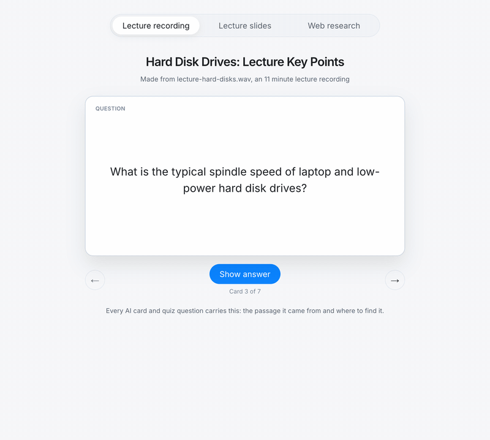

<picture>
  <source media="(prefers-color-scheme: dark)" srcset="https://raw.githubusercontent.com/Mnema-App/.github/main/profile/assets/banner-dark.svg">
  
</picture>

  

  

### What Mnema does

| | |
|---|---|
| **Lecture recordings** | Every card shows the second it was said, and you can listen from there. |
| **PDFs and slides** | Every card carries its page or slide number. |
| **Photos of your notes** | Word lists copied exactly as you wrote them. Labelled diagrams become label quizzes. |
| **Just a topic** | Researched on the web, with the page cited on every card. |

Spaced repetition with FSRS 6, cram mode for the night before, and quizzes. Bring your Anki decks with you.

  <a href="https://www.instagram.com/mnemaapp">Instagram</a> ·
  <a href="https://www.tiktok.com/@mnemaapp">TikTok</a> ·
  <a href="https://www.youtube.com/@mnemaapp">YouTube</a> ·
  <a href="https://www.linkedin.com/company/mnemaapp">LinkedIn</a> ·
  <a href="https://x.com/mnemaapp">X</a> ·
  <a href="https://www.threads.com/@mnemaapp">Threads</a>
   
  Built in Poland

